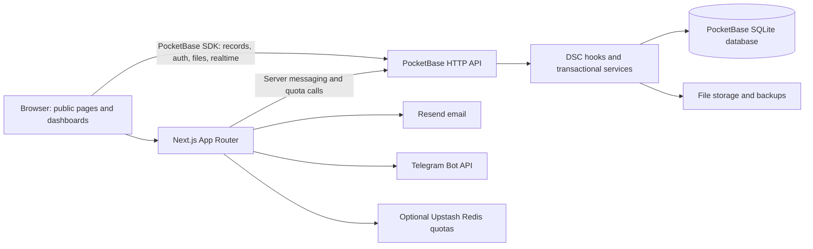
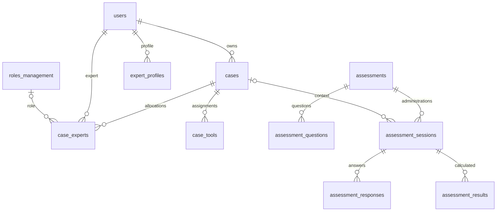

# DSC technical documentation

Repository-based system manual • 16 November 2026

## 1. Scope and evidence

This manual documents the application in this checkout: Next.js frontend/server routes, PocketBase hooks and migrations, data contracts, security, and operational workflows. It does not certify the deployed site's version, infrastructure, database contents, delivery configuration, or availability. No production services were contacted to prepare it.

Read this manual with the generated [technical reference](technical-reference.md), which inventories every page route, custom API registration, schema-snapshot field and rule, migration, environment-variable reference, and test file. The snapshot and later migrations must be reconciled to determine a database's effective schema; the snapshot alone is not a current production export.

Existing feature documents remain useful implementation supplements. Statements in those documents that a feature was deployed or remained local describe the time of that document, not a current deployment guarantee.

## 2. System purpose and actors

DSC combines a bilingual public website and service portals with customer case management, expert allocation, configurable assignments, assessments, events, communications, payments, and content administration.

| Actor/account type | Main experience |
| --- | --- |
| Visitor | Published portals, information, blog, programmes, lectures, registration and contact |
| Individual | Own cases, tasks, appointments, documents and reports |
| Parent | Owned child cases and their service journey |
| Care foundation | Parent dashboard routing with foundation registration semantics |
| Organization | Institution dashboard and projects |
| Expert | Submitted application, approved profile, allocated cases, assignments and schedule |
| Admin | Operational modules permitted by assigned security roles |
| Super Admin | Application security administration and privileged account management |

Account type (`users.role`) selects the dashboard and domain scope. Configurable security roles grant staff permissions. Specialist roles (`roles_management`) describe professional capabilities and allocations. These are three distinct concepts. PocketBase infrastructure superusers are separate from all three.

## 3. Architecture



The browser performs many authenticated operations directly against PocketBase. Next.js is therefore not the sole security boundary. PocketBase collection rules and custom hook handlers enforce record ownership, assignment, staff grants, and protected files independently of the UI.

The Next.js server additionally implements outbound notification endpoints under `app/api`. It does not replace PocketBase's business API. Public metadata and rendering use App Router conventions; interactive components, context providers and hooks implement authenticated workspaces.

### Technology baseline

Declared dependencies include Next.js `^16.4.2`, React/React DOM `^19.2.4`, TypeScript `^5.9.3`, PocketBase JS SDK `^0.26.8`, Tailwind CSS `^4.2.1`, Radix UI and shadcn-style components. Editor/content tooling includes SunEditor, CodeMirror, sanitize-html, htmlparser2 and SheetJS. Resend handles application email. Exact resolved versions belong to the lockfile, not these semver ranges.

Backend documentation names PocketBase 0.31.0 for the original snapshot; the local runtime documentation names 0.40.5. This is a compatibility gap to validate against the intended deployment binary. The SDK package version is not the PocketBase server version. The repository does not establish a single deployment-wide Node version; use a Node runtime compatible with the installed Next.js package and record it in deployment configuration.

### Repository organization

| Path | Responsibility |
| --- | --- |
| `app/` | Public/auth/dashboard/CMS pages, layouts, API handlers, metadata |
| `components/` | Shared UI and feature workspaces |
| `hooks/` | Data loading, permissions, profiles, assignments and realtime helpers |
| `lib/` | SDK client, collection adapters, validation, localization and domain logic |
| `types/` | Frontend contracts for users, cases, tools, profiles and CMS |
| `pb_hooks/` | Local PocketBase hooks and helper libraries |
| `pb_migrations/` | Local deployment migration copies |
| `backend/pb/` | Deployment backend sources, schema snapshot, seed/import utilities |
| `local-backend/` | Local bootstrap migrations and PowerShell launcher |
| `tests/` | Unit, regression and backend integration tests |
| `tools/` | Generated-artifact builders, project checks and translation audits |
| `docs/` | Architecture, feature and deployment documentation |

## 4. Frontend and navigation

`lib/dashboard-routes.ts` maps admin/super_admin to `/dashboard/admin`, expert to `/dashboard/expert`, organization to `/dashboard/institution`, individual to `/dashboard/individual`, parent/care_foundation to `/dashboard/parent`, and unknown roles to `/dashboard/cases`.

Public routes include `/`, `/portal/[id]`, `/info/[id]`, `/blog`, `/blog/[slug]`, `/programmes`, training programmes, public lectures, contact, privacy and terms. The root `/[slug]` route supports CMS-style public pages. Authentication pages are under the `(auth)` route group; the group itself is absent from public URLs.

Administration includes users, experts and review, cases, allocations, assignments, tools and assessments, payments, training, lectures, backups, security, and settings. Settings cover lookups, classifications, specialist categories, roles, tool types and payment configuration. CMS routes manage portals, home pages, information pages, blogs and categories.

`lib/pb.ts` creates the PocketBase SDK client, disables automatic request cancellation, exposes the SDK auth store, normalizes login/reset email, and translates backend validation errors. `lib/pb-collections.ts` maps database fields to frontend contracts; for example, tools use flattened bilingual fields in storage and nested bilingual names in UI objects. Hooks compose these adapters. `lib/bounded-records.ts` centralizes bounded list retrieval.

Arabic/English strings use `lib/i18n.ts`, language context, UI translation helpers and bilingual record fields. RTL layout and Arabic fonts require visual verification as well as string checks. Blog content is a notable single-authored-content exception: current code reads `title` and `content`, with legacy compatibility handled by blog helpers and migrations.

## 5. Authentication and authorization

Password login, auth refresh and password resets use the `users` auth collection. `getCurrentUser()` checks token validity before returning the stored model. A valid token alone does not prove the user remains active or has current grants: protected backend handlers reload current account/policy state.

Staff grants are the union of active assigned security roles. The security subsystem stores roles, permission catalog, role-permission links, user-role links and audit entries. `users.security_permissions` is a server-controlled projection used by native rules. New staff need operational grants; a compatibility system role supports migrated administrators.

Frontend navigation and route guards improve usability; native collection rules and custom route checks enforce access. Permission loading failures deny protected staff access. Super Admin invariants prevent self-demotion/deactivation/deletion and removal of the final active Super Admin. Staff cannot promote users through general profile editing. Expert approval uses a separate permission and audited transaction.

Payments use dedicated scoped endpoints. Cases Read does not imply financial-field access; payment export requires its own permission. Sensitive file access requires a current record entitlement and short-lived file token. Public avatars and published expert photos follow public access rules. Realtime authorization must also respond to revocation.

Implementation: `lib/security.ts`, `hooks/usePermissions.ts`, `pb_hooks/security-management.pb.js`, `backend/pb/pb_hooks/lib/security-policy.js`, `security-management.js` and `security-payments.js`. See [security management](../security-management.md) for invariants and migration details.

## 6. Domain workflows

### Registration and expert review

Customers register as individual, parent, organization or care foundation. Account/profile validation is implemented in frontend helpers and backend registration services; the server governs accepted types, required values and related records. Parent registration can create child case records; validation includes a maximum of 30 children per registration.

Expert application submission uses `/api/dsc/expert-register` after the frontend checks registration configuration. The backend transaction stores user, profile, files and optional bank details. A submission key supports safe retries. Pending experts remain inactive for operational access. Application notification failure does not reverse a committed application. Reviewers approve or reject through dedicated backend operations; approval checks the submitted profile and writes an audit entry. See [strict profile contract](../strict-profile-contract.md), [expert management](../expert-management-backend.md) and [role selection](../expert-role-selection.md).

### Cases, projects and expert allocations

`cases.user` defines ownership. Case/project terminology varies by customer workspace; the shared case model includes service classification, user/case JSON details, workflow state and payment-related fields. `case_experts` connects a case to an expert and specialist role through `case_id`, `expert_id` and `role_id`.

Allocation saving is validated server-side. Current allocations govern expert access, not historical ownership or a cached UI selection. Role/category catalogs and supported tool types constrain selection. General-role and newer role-category migrations extend the older `role_id` model; inspect their migration definitions before migrating a legacy database.

### Tools and assignments

Reusable tools define configurations; `case_tools` stores case-specific work, configuration, responses, visibility, media and assignment metadata. Types include surveys, multiple choice, reports, plans, attachment requests, meetings and assessments through their respective workspaces. Assignment status values are `pending`, `assigned`, `in_progress` and `completed`.

Expert custom-assignment routes enforce allocation boundaries. A server-derived `can_edit_configuration` flag controls configuration editing; `assigned_expert` alone is insufficient evidence of permission. Tool templates have dedicated list/detail/save/approve and case-assignment/draft endpoints. Responses and configuration are distinct contracts; assignment-response hooks validate submission rather than trusting browser-calculated state. Notifications and read tracking are implemented by separate assignment hooks.

### Assessments

Five core collections hold definitions, questions, sessions, responses and results. Draft definitions must pass server preview before publishing; edits reset tested status. Published definitions are immutable and new revisions are cloned. Sessions pin a definition/question snapshot to preserve reproducibility.

Scoring supports sums, means, percentages, weighted means, condition counts, arithmetic formulas and normative tables. Reverse scoring uses actual answer-set bounds. Missing-answer policy and minimum-answer requirements are explicit. Formulas use a restricted arithmetic grammar, not arbitrary JavaScript. Backend calculations govern results.

Client delivery resolves the recipient from case ownership. Clients see permitted question/answer content and their submission state; professional scoring rules, norms, results and alerts are excluded from client APIs. Assignment and ownership are rechecked on access. Completed submissions are locked. Clinical validity requires separately reviewed content and norms; the generic engine does not establish it. See [assessment builder and scoring](../assessment-builder.md).

### Communications and documents

Internal messages support subjects, recipients, case links, read state and protected attachments. The unified inbox and administrator visibility behavior have later migrations; use those rules when evaluating current access, rather than assuming the original private-message rules are unchanged.

Case message handlers check sender, recipient, case ownership and current allocation. Message content/provenance is immutable through regular updates; read marking is separately constrained. Case documents are protected records with uploader/source provenance. Saving a message attachment to documents copies storage bytes and deduplicates imports; the document survives independently of the original attachment. Document APIs limit uploads to authorized staff/experts. See [case messages](../case-messages.md) and [case documents](../case-documents.md); their deployment statements are historical.

External contact and consultation requests use Next.js email endpoints. Consultation email can succeed while Telegram fails; the response exposes `notificationPending` rather than reporting the accepted email as failed. This is separate from in-app messaging and assessment delivery.

### Payments

Cases carry payment amount, receipt, paid state and rejection information. Customer receipt upload and staff financial changes have different permissions and validation. Bank details are configured in settings. The code implements receipt/review workflows; it does not establish an integrated card-payment processor. See `lib/payment.ts`, `lib/payment-case-status.ts` and security payment handlers.

### Programmes and public lectures

Training programmes and public lectures contain bilingual/JSON descriptive fields, schedules, capacity, status, meeting/recording links and public visibility. Registrations and certificates use dedicated records. Enrollment routes and record hooks enforce server-side enrollment behavior; UI registration counts alone are not an integrity boundary. Public views expose a smaller projection than management records.

### CMS and classification

Portals configure public service entry points, registration type, imagery and layout configuration. Home/info/blog records provide published content and files. Custom HTML layout handling and sanitization live in CMS/content helpers. Shared classifications connect content and services; keys, labels, active state and ordering require coordinated migration and UI handling. See [CMS portals](../cms-portals.md), [custom layouts](../cms-custom-layouts.md), [classification](../unified-classification.md) and [blog content](../blog-single-authored-content.md).

## 7. Data model and schema evolution

The generated reference provides the exact committed snapshot fields, types, options, indexes and access rules. [Existing ERD](../full-data-erd.md) is a useful conceptual diagram but explicitly stops at earlier migrations and omits newer entities/changes.



This diagram summarizes key relationships; it is not an exhaustive constraint definition. Some business identifiers are text rather than declared relations. Do not assume automatic referential integrity for text IDs or one profile per user unless indexes/hooks enforce it.

The schema snapshot is a baseline. Additive migrations after it introduce fields, collections, rules and data transformations, including messaging quotas, case messages/documents, expert review, unified inbox, notifications and role sequencing. Root/backend migration and hook trees are separate deployment surfaces and may diverge; the reference lists file differences. `pb_migrations_legacy` is historical and must not be loaded indiscriminately.

## 8. API contracts

Two origins expose APIs: the Next.js site under `/api/*` and PocketBase under `/api/dsc/*` plus standard collection/auth/file endpoints. The generated reference lists every statically declared custom route with its exact method, path, source and line. A registered authentication middleware is only the first gate; helper logic determines current role, permission, record scope and payload validation.

PocketBase record endpoints follow `/api/collections/{collection}/records`; standard SDK auth and file methods supply the related routes. Use SDK `pb.filter` placeholders for user input rather than interpolated filter text. File-bearing writes use FormData. File URLs must respect protection rules and may require a token.

Next.js messaging handlers require JSON, reject mismatched supplied origins, and limit body reads to 32 KiB by default. Shared client quotas are five requests per minute when a trusted client IP is available; global delivery reservations are 30 per minute. Redis is preferred when both Redis variables exist; otherwise the backend quota endpoint requires a matching secret of at least 32 characters. Missing infrastructure fails closed. Local demo quotas are process memory and are unsuitable for a production multi-instance deployment.

Typical errors include malformed input/validation (400), authentication failure (401), scope/permission denial (403), oversized request (413), unsupported media type (415), quota exhaustion (429), and unavailable quota/delivery infrastructure (503 or handler-normalized failure). Do not assume all custom APIs share a success envelope: some return records, some arrays/pagination, and others `{success:true}`. The route/helper source is authoritative for each request and response.

Example authenticated policy lookup using the application SDK:

```ts
const policy = await pb.send('/api/dsc/security/me', { method: 'GET' })
// { permissions: string[], is_super_admin: boolean }
```

Contact JSON contains `name`, `email`, `countryCode`, `phoneNumber`, `description`, and optional `lang`. Successful contact delivery returns `{success:true}`; field validation returns `{errors: ...}` with status 400. Consultation JSON accepts identity/contact and request-detail fields listed in `app/api/send-message/route.ts`; its response includes `message` and potentially `notificationPending`.

## 9. Configuration and integrations

| Variable | Consumer and purpose |
| --- | --- |
| `NEXT_PUBLIC_POCKETBASE_URL` | Browser/server backend origin; fallback `http://127.0.0.1:8090` |
| `NEXT_PUBLIC_SITE_URL` | Public canonical/SEO origin; fallback `https://dsc.ac` |
| `RESEND_API_KEY` | Server email provider authentication |
| `BOT_TOKEN` | Server Telegram bot authentication |
| `UPSTASH_REDIS_REST_URL`, `UPSTASH_REDIS_REST_TOKEN` | Shared Redis quota service, configured together |
| `DSC_MESSAGING_QUOTA_SECRET` | Matching server-only Next.js/PocketBase fallback quota credential |
| `DSC_TRUST_PROXY` | Trust forwarded client IP only when proxy overwrites it |
| `NETLIFY` | Enables platform client-IP header handling |
| `DSC_LOCAL_BACKEND` | Explicit local simulation/quota mode; remove for production |
| `PB_URL`, `PB_SUPERUSER_EMAIL`, `PB_SUPERUSER_PASSWORD` | Backend administrative import/seed scripts only |
| `APP_ADMIN_EMAIL`, `APP_ADMIN_PASSWORD` | Initial application admin seed |
| `SECURITY_TEST_POCKETBASE` | Disposable security-test binary override |

Never put provider, quota, database-superuser or seed credentials in `NEXT_PUBLIC_*` variables. Public variables are bundled into the frontend; rebuild for changes. The full source-discovered configuration inventory is in the reference. `.env.local` values are intentionally excluded from this documentation.

Email sender/destination addresses and Telegram chat targets are currently embedded in handlers. Changing a target can require a code deployment. Confirm provider domain verification, SMTP/reset-mail configuration and bot permissions in the actual environment. PocketBase password reset delivery is separate from Resend request notifications.

`next.config.mjs` derives permitted PocketBase image URLs from the backend origin and includes additional legacy hosts. Local development bypasses image optimization for localhost PocketBase. Review origin and image configuration when changing hosting.

## 10. Local setup

Run commands from the repository root (`dsc`), with Node/npm, Python 3.10+ for project tooling, and the intended PocketBase binary available.

```powershell
npm ci
# Configure .env.local with local, non-production values.
# NEXT_PUBLIC_POCKETBASE_URL=http://127.0.0.1:8090
# DSC_LOCAL_BACKEND=true
./local-backend/start.ps1
```

In another terminal:

```powershell
npm run dev
```

The backend launcher resolves the runtime to the workspace sibling `work/pocketbase`, stores data under its `pb_data`, copies local bootstrap and root migrations into runtime `migrations`, binds `127.0.0.1:8090`, and explicitly loads root `pb_hooks`. The frontend normally serves on port 3000. The runtime is not installed by `npm ci`; provision it separately. The local baseline is inferred and may not support every module without further reviewed migrations.

`-SkipMigrations` selects an empty migration directory and disables automigration; it is useful only with a compatible pre-existing local database. It does not repair a missing schema. Local demo credentials are described in the local-backend README; never reuse them in hosted environments.

For a new empty standalone backend, provision an infrastructure superuser, explicitly configure data/hooks/migration paths, import the reviewed baseline, apply the required additive migrations, and seed defaults. `backend/pb/import-schema.mjs` sets `deleteMissing:true`: use it only for an intentionally disposable or empty target. A populated deployment requires reviewed additive upgrades.

## 11. Build, deployment and recovery

Frontend and backend deploy independently. A frontend Git push does not install PocketBase hooks or migrate its database. Deploy compatible backend changes before frontend code that depends on new endpoints/fields.

1. Record the target environment, binary version, application revision, effective schema and migration history.
2. Take a consistent database/files backup and preserve the previous hooks, migration set and frontend release. Verify restore access.
3. Review the pending migration set against that exact database. Avoid copying every historical/bootstrap migration into an existing production instance.
4. Generate required artifacts and compare root/backend copies. Install matching hook libraries and reviewed migrations using explicit paths.
5. Run PocketBase migrations for the target, restart the intended service, inspect startup errors and query health.
6. Build/deploy Next.js with the intended public and server-only configuration.
7. Verify login, policy loading, customer isolation, expert allocation, private downloads, one assignment flow, email/quota behavior and relevant Arabic/mobile screens using disposable records.
8. Record deployment revision, migration names and verification outcomes.

```powershell
npm run typecheck
npm run lint
npm run build
# Standard Node-hosted production process:
npm run start
```

For PocketBase use explicit `--dir`, `--hooksDir`, and `--migrationsDir` arguments. Historical backend README wording about automatic path discovery is insufficient for a production runbook. Actual service unit/proxy/TLS/DNS configuration must be obtained from the deployment environment; this checkout does not establish a complete infrastructure manifest.

Backups must include database and uploaded files plus service configuration needed to restore. Administrative backup APIs have permission checks; object-storage configuration and retention still require environment verification. See [backup setup](../b2-backup-setup-2026-10-26.md). No recovery point objective, recovery time objective, retention policy or availability SLA is proven by this code.

Several migrations intentionally refuse destructive rollback. Recovery may require a reviewed consistent backup plus coordinated frontend/backend rollback. Test restoration in an isolated instance, including authentication, protected files and record counts. Keep restricted access to backups because they can contain client records, assessment responses and credentials/configuration.

## 12. Validation and maintenance

| Check | Command or source |
| --- | --- |
| TypeScript | `npm run typecheck` |
| Lint | `npm run lint` |
| Production compilation | `npm run build` |
| UI translation audit | `npm run audit:translations` |
| Localization tests | `npm run test:localization` |
| Security with upgrade baseline | `npm run test:security` |
| Security with canonical baseline | `npm run test:security:canonical` |
| Assessment engine artifact | `node tools/build-assessment-engine.cjs` |
| Security artifacts | `npm run security:generate` |
| Classification artifacts | `node tools/build-classification-artifacts.cjs` |
| Static project checker | `python tools/check_project.py --static-only` |
| Checker including diagnostics | `python tools/check_project.py` |

The checker discovers selected unit tests; build is opt-in. Standalone integration scripts are not a universal safe test suite: inspect each target, credentials and cleanup behavior before execution. Security integration tests document disposable temporary databases; other integration tests may require a specific local server or database copy. The reference inventories all tests without claiming they passed in this documentation task.

Changes to generated security/assessment/classification artifacts require their corresponding generator and diff review. Never regenerate and deploy blindly over unrelated local changes. Add new protected modules to policy mapping and native rules as well as frontend navigation. Test direct HTTP denials, not just hidden buttons.

Monitor PocketBase startup/migration errors, API failures, quota 429/503 rates, provider delivery failures, disk/storage growth, backup success and restore freshness. Infrastructure dashboards and alert routing are environment responsibilities; no consolidated telemetry platform is established here. Avoid logging tokens, clinical answers, private file links or whole request bodies.

## 13. Troubleshooting

| Symptom | Investigation |
| --- | --- |
| Login succeeds but staff workspace is denied | Active status, `/api/dsc/security/me`, assigned active roles, hook/migration compatibility |
| Pending expert cannot open operational pages | Expected until review; check profile and approval operation rather than changing role blindly |
| New screen reports missing collection/field | Compare effective backend schema and pending feature migrations |
| Expert loses case/files access | Verify current `case_experts` allocation and role; revocation is intentional |
| Messaging returns 503 | Check both Redis settings or matching fallback quota secret and backend quota hook |
| Messaging returns 429 | Inspect client/global quota exhaustion; do not disable shared enforcement |
| Email accepted but Telegram pending | Verify bot target/permissions; avoid resending accepted email unnecessarily |
| Protected attachment fails | Current record access, valid file token, stored bytes and backend origin |
| Images fail only locally | PocketBase origin and Next.js image configuration; restart/rebuild as required |
| Reset link points to wrong site | Reset-mail hook/template and deployed frontend origin configuration |
| CMS text/layout differs from editor | Sanitization, stored HTML, custom layout, language and legacy blog compatibility |

## 14. Known limits and documentation upkeep

This documentation was produced by static source inspection. It does not establish current production migration status, full API payload schemas, clinical validity, performance capacity, dependency vulnerability status, browser accessibility compliance or disaster-recovery readiness. Current helpers are the authoritative contract where this manual summarizes behavior.

The [technical reference](technical-reference.md) is reproducible using `python tools/generate_technical_reference.py`. It includes a source-content fingerprint, snapshot counts and deployment-copy differences. Regenerate it after changing routes, schema, migrations, tests or configuration references. Review this manual alongside domain changes; retain dated deployment reports as historical evidence.
