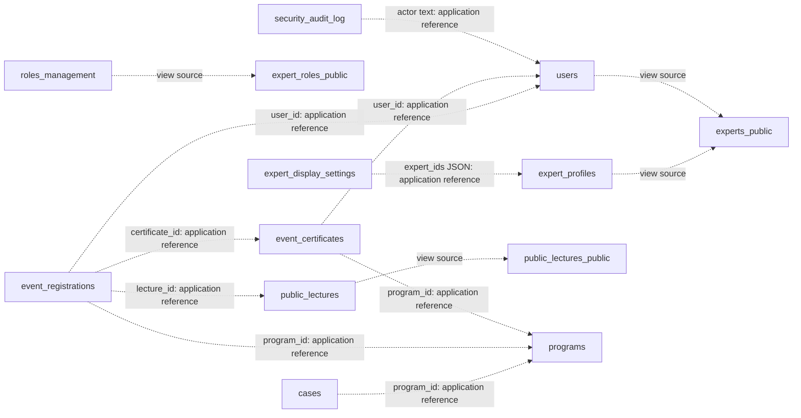

# DSC — Complete application ERD

Scope: 41 application collections, including 3 views. Source: `backend/pb/pb_schema.json` plus reviewed migration definitions through `1794100300_messaging_quotas.js`. This is a repository-derived model, not an export of the production database. PocketBase internal system tables are outside this application ERD.

The uncommitted `1794200000` repair is excluded. The repository schema already defines allocation roles through `role_id`; the observed production legacy `case_experts.role` field is a known schema difference, not part of this canonical model.

## All collections, fields, and declared relations

`PK` = record ID; `FK` = PocketBase relation field. `||` = exactly one, `|o` = optional one, `o{` = zero or many, `}o` = many-valued relation. Text or JSON containing an ID is not marked FK. Multiple records per user are shown where the schema does not enforce uniqueness, even if the UI intends a single profile. Public views are read-only projections.

```mermaid
erDiagram
    users {
        text id PK
        text role
        text name
        file avatar
        text contact_number
        text organization_name
        text user_type
        text message
        bool is_active
        file attachments
        autodate created
        autodate updated
        password password
        text tokenKey
        email email
        bool emailVisibility
        bool verified
        select security_permissions
    }
    lookups {
        text id PK
        text type
        text key
        text label_en
        text label_ar
        number order
        bool is_active
        autodate created
        autodate updated
    }
    blog_categories {
        text id PK
        text key
        text label_en
        text label_ar
        autodate created
        autodate updated
        select main_category
    }
    tool_types {
        text id PK
        text name
        relation user FK
        text expert_id
        text title
        text status
        autodate created
        autodate updated
    }
    roles_management {
        text id PK
        text role_name_en
        text role_name_ar
        relation_list tool_types FK
        text expert_id
        text title
        text name
        text status
        autodate created
        autodate updated
        text role_group
        number role_order
        bool is_retired
        relation category FK
        bool is_active
        number order
        text key
    }
    cases {
        text id PK
        relation user FK
        text expert_id
        text title
        text name
        text status
        text date_of_birth
        text gender
        text grade
        text relationship
        text notes
        text category
        text sub_category
        text service_type
        text portal_type
        text training_link
        text program_id
        text program_status
        text payment_reject_reason
        json case_details
        json user_details
        bool is_paid
        number payment_amount
        file payment_slip
        autodate created
        autodate updated
    }
    case_experts {
        text id PK
        relation case_id FK
        relation expert_id FK
        relation role_id FK
        autodate created
        autodate updated
    }
    case_tools {
        text id PK
        relation case FK
        relation type FK
        text expert_id
        text title
        text name
        text status
        text name_en
        text name_ar
        text assigned_at
        json config
        json responses
        bool is_visible_to_user
        bool is_not_template
        file media
        relation assigned_expert FK
        text specialization
        text task_brief
        autodate created
        autodate updated
    }
    case_feedback {
        text id PK
        relation case FK
        relation author FK
        number rating
        text comment
        autodate created
        autodate updated
    }
    expert_profiles {
        text id PK
        relation user FK
        text full_legal_name
        text nationality
        text country_of_residence
        text city
        text whatsapp_country_code
        text whatsapp_number
        text highest_academic_degree
        text degree_title
        text field_of_study
        text consultation_mode
        text fee
        text availability
        text bio
        text client_type
        text preferred_languages
        text status
        json age_group
        text specialization_type
        file profile_photo
        file cv
        text short_bio_en
        text short_bio_ar
        text public_name_en
        text public_name_ar
        text public_qualification_en
        text public_qualification_ar
        text public_specialty_en
        text public_specialty_ar
        autodate created
        autodate updated
        relation_list specialist_roles FK
        text submission_key
    }
    expert_bank_details {
        text id PK
        relation user FK
        text iban
        autodate created
        autodate updated
    }
    expert_display_settings {
        text id PK
        text key
        json expert_ids
        autodate created
        autodate updated
    }
    experts_public {
        text id PK
        text name
        file profile_photo
        text degree_title
        text specialization_type
        text short_bio_en
        text short_bio_ar
        text public_name_en
        text public_name_ar
        text public_qualification_en
        text public_qualification_ar
        text public_specialty_en
        text public_specialty_ar
        relation_list specialist_roles FK
    }
    event_certificates {
        text id PK
        text user_id
        text program_id
        text user_name
        text certificate_number
        text issue_date
        text notes
        json program_name
        file file
        autodate created
        autodate updated
    }
    event_registrations {
        text id PK
        text program_id
        text lecture_id
        text user_id
        text user_name
        text email
        text phone
        text registered_at
        text status
        text certificate_id
        text notes
        autodate created
        autodate updated
    }
    home_pages {
        text id PK
        text slug
        text portal_name
        text title_en
        text title_ar
        text content_en
        text content_ar
        text author_name
        text icon
        text category
        bool is_published
        number order
        file media
        file thumbnail
        autodate created
        autodate updated
    }
    info_pages {
        text id PK
        text slug
        text portal_name
        text title_en
        text title_ar
        text content_en
        text content_ar
        text author_name
        text category
        file icon
        bool is_published
        number order
        file media
        file thumbnail
        autodate created
        autodate updated
    }
    blog_pages {
        text id PK
        text slug
        text portal_name
        text title_en
        text title_ar
        text content_en
        text content_ar
        text author_name
        text icon
        text category
        bool is_published
        number order
        file media
        file thumbnail
        autodate created
        autodate updated
        select main_category
        text keywords
    }
    individual_profiles {
        text id PK
        relation user FK
        text full_legal_name
        text gender
        text date_of_birth
        text nationality
        text country_of_residence
        text emergency_contact_name
        text emergency_contact_phone
        text notes
        text preferred_languages
        autodate created
        autodate updated
        text submission_key
    }
    organization_profiles {
        text id PK
        relation user FK
        text full_legal_name
        text organization_name
        text organization_type
        text country
        text city
        text website
        text responsible_person_name
        text responsible_person_title
        text responsible_person_phone
        text preferred_languages
        text notes
        autodate created
        autodate updated
        text submission_key
        text address
    }
    parent_profiles {
        text id PK
        relation user FK
        text full_legal_name
        text nationality
        text country_of_residence
        text notes
        text preferred_languages
        autodate created
        autodate updated
        text submission_key
    }
    internal_messages {
        text id PK
        relation sender FK
        relation recipient FK
        text body
        bool read
        autodate created
        autodate updated
        text subject
    }
    portals {
        text id PK
        text portal_key
        text title_en
        text title_ar
        text description_en
        text description_ar
        select icon
        file picture
        select registration_type
        text accent
        number order
        bool is_deleted
        json config
        autodate created
        autodate updated
    }
    programs {
        text id PK
        json name
        json category
        json trainer_name
        text coordinator
        text type
        text location
        number duration
        json goals
        text notes
        json schedule
        number max_participants
        number current_registrations
        text meeting_link
        text recording_url
        bool is_public
        text status
        file thumbnail
        autodate created
        autodate updated
        select main_category
        text subcategory
        text keywords
    }
    public_lectures {
        text id PK
        json title
        json description
        json speaker
        json schedule
        number duration
        number max_participants
        number current_registrations
        text status
        text type
        text location
        text coordinator
        text notes
        text meeting_link
        text recording_url
        bool is_public
        file thumbnail
        autodate created
        autodate updated
        select main_category
        text subcategory
        text keywords
    }
    public_lectures_public {
        text id PK
        json title
        json description
        json speaker
        json schedule
        number duration
        file thumbnail
        text status
        bool is_public
        number current_registrations
        autodate created
        autodate updated
        json main_category
        json subcategory
    }
    settings {
        text id PK
        json payment_bank_details
        text key
        text value
        json data
        autodate created
        autodate updated
    }
    tools {
        text id PK
        text name_en
        text name_ar
        text description
        text description_en
        text description_ar
        text type
        text serviceType
        text status
        json config
        file media
        text expert_id
        text title
        text name
        autodate created
        autodate updated
    }
    expert_roles_public {
        text id PK
        text role_name_en
        text role_name_ar
        text role_group
        number role_order
        bool is_retired
    }
    specialist_role_categories {
        text id PK
        text key
        text name_en
        text name_ar
        number order
        bool is_active
        bool media_only
    }
    security_roles {
        text id PK
        text key
        text name_en
        text name_ar
        text description
        bool is_active
        bool is_system
        autodate created
        autodate updated
    }
    security_permissions {
        text id PK
        text key
        text module
        text action
        text name_en
        text name_ar
        autodate created
        autodate updated
    }
    security_role_permissions {
        text id PK
        relation role FK
        relation permission FK
        autodate created
        autodate updated
    }
    security_user_roles {
        text id PK
        relation user FK
        relation role FK
        autodate created
        autodate updated
    }
    security_audit_log {
        text id PK
        text actor
        text action
        text target_type
        text target_id
        json before
        json after
        autodate created
        autodate updated
    }
    assessments {
        text id PK
        text name
        text code
        text version
        select status
        json definition
        bool tested
        relation author FK
        autodate created
        autodate updated
    }
    assessment_questions {
        text id PK
        relation assessment FK
        text key
        number position
        json definition
        autodate created
        autodate updated
    }
    assessment_sessions {
        text id PK
        relation assessment FK
        relation case FK
        relation operator FK
        relation recipient FK
        select status
        json snapshot
        json population
        text assigned_at
        text submitted_at
        autodate created
        autodate updated
    }
    assessment_responses {
        text id PK
        relation session FK
        json answers
        autodate created
        autodate updated
    }
    assessment_results {
        text id PK
        relation session FK
        json result
        autodate created
        autodate updated
    }
    messaging_quotas {
        text id PK
        text key
        number count
        number expires
    }
    users |o--o{ tool_types : "user"
    lookups }o--o{ roles_management : "tool_types"
    specialist_role_categories |o--o{ roles_management : "category"
    users ||--o{ cases : "user"
    cases ||--o{ case_experts : "case_id"
    users ||--o{ case_experts : "expert_id"
    roles_management |o--o{ case_experts : "role_id"
    cases ||--o{ case_tools : "case"
    lookups ||--o{ case_tools : "type"
    users |o--o{ case_tools : "assigned_expert"
    cases ||--o{ case_feedback : "case"
    users ||--o{ case_feedback : "author"
    users ||--o{ expert_profiles : "user"
    roles_management }o--o{ expert_profiles : "specialist_roles"
    users ||--o{ expert_bank_details : "user"
    roles_management }o--o{ experts_public : "specialist_roles"
    users ||--o{ individual_profiles : "user"
    users ||--o{ organization_profiles : "user"
    users ||--o{ parent_profiles : "user"
    users ||--o{ internal_messages : "sender"
    users ||--o{ internal_messages : "recipient"
    security_roles ||--o{ security_role_permissions : "role"
    security_permissions ||--o{ security_role_permissions : "permission"
    users ||--o{ security_user_roles : "user"
    security_roles ||--o{ security_user_roles : "role"
    users ||--o{ assessments : "author"
    assessments ||--o{ assessment_questions : "assessment"
    assessments ||--o{ assessment_sessions : "assessment"
    cases ||--o{ assessment_sessions : "case"
    users ||--o{ assessment_sessions : "operator"
    users |o--o{ assessment_sessions : "recipient"
    assessment_sessions ||--o| assessment_responses : "session"
    assessment_sessions ||--o| assessment_results : "session"
```

## View sources and application-level references

Dotted arrows below are query dependencies or references stored in text/JSON, not declared foreign keys. Their cardinality and integrity are not enforced by PocketBase relation fields. This supplementary diagram highlights known application references; free-form JSON configuration can contain further IDs.

## Collection inventory

| Collection | Kind | Fields |
|---|---|---:|
| `users` | auth | 18 |
| `lookups` | base | 9 |
| `blog_categories` | base | 7 |
| `tool_types` | base | 8 |
| `roles_management` | base | 17 |
| `cases` | base | 26 |
| `case_experts` | base | 6 |
| `case_tools` | base | 20 |
| `case_feedback` | base | 7 |
| `expert_profiles` | base | 34 |
| `expert_bank_details` | base | 5 |
| `expert_display_settings` | base | 5 |
| `experts_public` | view | 14 |
| `event_certificates` | base | 11 |
| `event_registrations` | base | 13 |
| `home_pages` | base | 16 |
| `info_pages` | base | 16 |
| `blog_pages` | base | 18 |
| `individual_profiles` | base | 14 |
| `organization_profiles` | base | 17 |
| `parent_profiles` | base | 10 |
| `internal_messages` | base | 8 |
| `portals` | base | 15 |
| `programs` | base | 23 |
| `public_lectures` | base | 22 |
| `public_lectures_public` | view | 14 |
| `settings` | base | 7 |
| `tools` | base | 16 |
| `expert_roles_public` | view | 6 |
| `specialist_role_categories` | base | 7 |
| `security_roles` | base | 9 |
| `security_permissions` | base | 8 |
| `security_role_permissions` | base | 5 |
| `security_user_roles` | base | 5 |
| `security_audit_log` | base | 9 |
| `assessments` | base | 10 |
| `assessment_questions` | base | 7 |
| `assessment_sessions` | base | 12 |
| `assessment_responses` | base | 5 |
| `assessment_results` | base | 5 |
| `messaging_quotas` | base | 4 |

## Important distinctions

- Professional roles (`roles_management`) and staff access roles (`security_roles`) serve different functions.
- `case_tools.type` and `roles_management.tool_types` relate to `lookups` in the schema; the separate `tools` and `tool_types` collections have no declared relation to those fields.
- `event_registrations` remains stored; the later training migration directs training enrollment workflows to `cases.program_id`.
- `security_audit_log.target_id` is a polymorphic text reference determined by `target_type`, not a relation to a single collection.
- Classification keys, portal keys, and IDs inside configuration JSON are not drawn as database-enforced relations.
- Unique session indexes restrict assessment responses and results to at most one record per session.
- A live schema export is required to verify which migrations and field definitions are present on each server.
